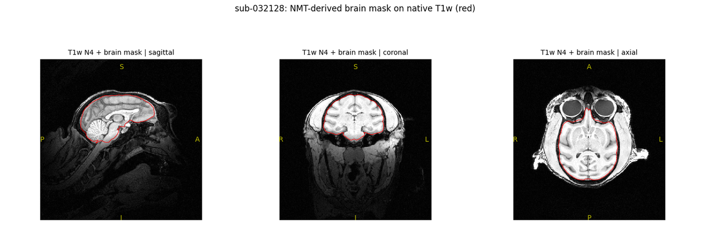
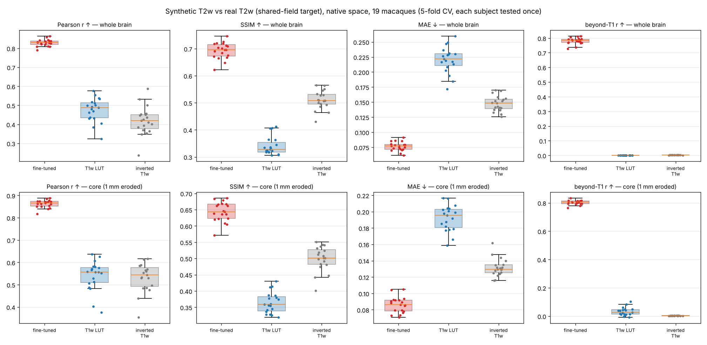
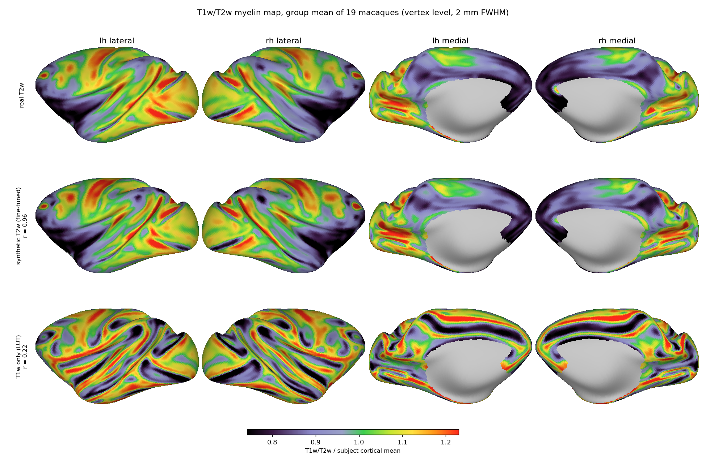
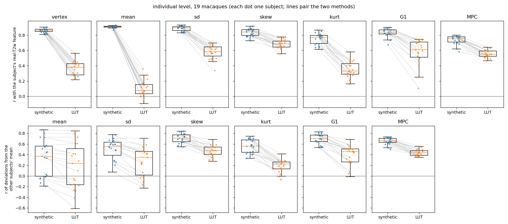
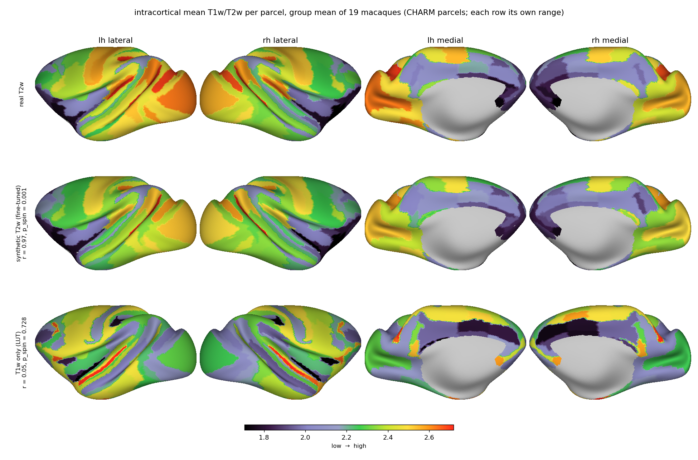
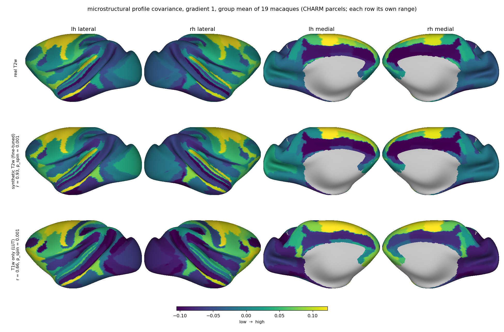

# Synthetic T2w for macaque MRI: adapting GAN-MAT from human to rhesus macaque

This repository adapts **GAN-MAT** (Park et al., *NeuroImage* 2024), a 3D pix2pix generator
trained on human HCP data to synthesise T2-weighted (T2w) images from T1-weighted (T1w)
images, to the **rhesus macaque**, and tests whether the synthetic T2w is good enough for
**T1w/T2w myelin mapping**, so that macaque datasets with only T1w can still be used for
myelin-sensitive analyses.

**Main findings** (19 macaques, PRIME-DE UC Davis, 5-fold subject-level cross-validation,
every subject evaluated once as an unseen test subject):

1. **Bias correction decides whether T1w/T2w myelin mapping works.** Correcting T1w and T2w
   with two separate N4 fields removes the cortical myelin pattern from the T1w/T2w ratio
   (vertex r with the raw-ratio map 0.14). The final model is therefore trained on a T2w
   target corrected with the **T1w's own N4 field** (a shared field, as in the HCP
   `T1w_restore`/`T2w_restore` images GAN-MAT was trained on), so that
   N4 T1w / target = raw T1w / raw T2w.
2. **Image level.** The fine-tuned synthetic T2w beats the best voxel-wise mapping from T1w
   intensity (a lookup table learned on the training subjects) on every image metric in
   19/19 subjects, whole brain and core (Wilcoxon p = 4·10⁻⁶): whole-brain Pearson r 0.83 vs
   0.48, SSIM 0.69 vs 0.34, and it carries T2w information that T1w intensity cannot explain
   (partial correlation given T1w 0.78).
3. **Myelin maps.** Surface T1w/T2w myelin maps from the synthetic T2w reproduce those from the
   real T2w: group map r = 0.96 (vertex level) / 0.97 (parcel means), MPC gradient 1 r = 0.93;
   per subject 0.86 (vertex), 0.91 (parcel means), 0.83 (gradient), versus 0.36, 0.10 and
   0.58 for the T1w-only control (19/19 subjects). Individual deviations from the group are
   reproduced clearly for laminar-profile features (gradient, MPC, skewness: r 0.65–0.71) but
   only weakly for the mean myelin map (r 0.33).

Model weights are not released (see [Model weights](#model-weights)). Imaging data are not
included (see [Data](#data)).

---

## Contents

1. [Repository layout](#repository-layout)
2. [Data](#data)
3. [Requirements](#requirements)
4. [Pipeline and how to reproduce](#pipeline-and-how-to-reproduce)
5. [Preprocessing](#preprocessing)
6. [How we fine-tune](#how-we-fine-tune)
7. [How we compare](#how-we-compare)
8. [How the scores are computed](#how-the-scores-are-computed)
9. [Results: synthetic T2w](#results-synthetic-t2w)
10. [Downstream T1w/T2w myelin analysis](#downstream-t1wt2w-myelin-analysis)
11. [Comparison with the original GAN-MAT paper](#comparison-with-the-original-gan-mat-paper)
12. [Development notes and limitations](#development-notes-and-limitations)
13. [Model weights](#model-weights)
14. [Acknowledgements and references](#acknowledgements-and-references)

---

## Repository layout

```
scripts/
  ganmat_env.example.sh   environment template -> copy to ganmat_env.sh and edit
  01_audit.sh             read-only environment check (tools, GPU, data, network)
  02_setup_tools.sh       no-sudo install of ANTs, NMT v2.1 template, Python packages
  06_fetch_ucdavis.py     inventory + download of PRIME-DE UC Davis T1w/T2w
  03_probe_conventions.py measures GAN-MAT's input/target conventions vs the macaque brain
  04_preprocess.py        per-subject macaque preprocessing (9 stages, QC figures, manifest)
  04_run_prep.sh          runs 04 for several subjects in parallel
  04b_seg_check.py        FAST vs SyN-warped NMT segmentation check
  04c_seg_priors.py       FAST with NMT priors; also writes the NMT labels used for evaluation
  04d_nmt_channels.py     input channels from NMT labels (segmentation ablation)
  04e_cohort_qc.py        cohort QC table + montages
  04f_prep_progress.py    progress monitor for batch preprocessing
  04b_shared_bias_target.py  T2w training target corrected with the T1w's N4 field (final target)
  05_e2_zeroshot.py       native-space evaluation of any generator checkpoint (+ baselines)
  07_finetune.py          fine-tuning (k-fold splits, frozen BN, masked L1, grad accumulation)
  07_run_cv.sh            runs the folds of one experiment, one fold per GPU
  07b_e3_summary.py       training/validation curves of all runs
  08_eval_cv.py           evaluates every fold, aggregates all subjects, paired tests
  08b_plot_image_metrics.py  per-subject image-metric figure
  10_myelin.py            surface T1w/T2w myelin analysis (MacaqueYerkes19 surfaces, GAN-MAT features)
results/                  final result tables (CSV)
docs/figures/             QC and result figures
```

The scripts import each other by file name (for example `05_e2_zeroshot.py` reuses the I/O
and QC helpers of `04_preprocess.py`), so keep them in one folder.

## Data

**PRIME-DE, University of California Davis site**: 19 rhesus macaques, anaesthetised,
Siemens Skyra 3T, T1w and T2w at 0.3 mm isotropic (T2w field of view is an exact sub-grid
of the T1w grid). The data are distributed under **CC-BY-NC-SA** by the PRIME-DE consortium
(fcon_1000.projects.nitrc.org/indi/PRIME). They are **not** included here; derived images
(synthetic T2w, ratio maps) are not included either. `06_fetch_ucdavis.py` downloads the
anatomical images from the public `fcp-indi` S3 bucket, or extracts them from the archive
downloaded from the NITRC portal (`--tarball`).

Users of the data must cite PRIME-DE (Milham et al., 2018) and acknowledge the UC Davis
contributors as requested by the PRIME-DE site page.

## Requirements

| Component | Version used | Role |
|---|---|---|
| Python | 3.10 | all scripts (see `requirements.txt`) |
| PyTorch | 2.x with CUDA (bf16 autocast) | generator training and inference |
| ANTs | 2.6.5 | N4, registration, resampling |
| FSL | 6.0.7 | FAST tissue segmentation |
| NMT v2.1 symmetric | — | macaque template, brain mask, segmentation, CHARM atlas |
| MacaqueYerkes19 v1.2 32k_fs_LR | — | template white / pial / inflated / sphere surfaces for the myelin analysis (BALSA, Donahue et al. 2016) |
| GAN-MAT | commit `414f2c7` + released `model.pth` | architecture and human weights |

GPU: one NVIDIA RTX A5000 (24 GB) per training run; a run uses ~7.5 GB and ~2.7 s per
optimiser step at batch 8 (≈15 min for 200 epochs). Preprocessing is CPU-only
(~30–40 min per subject with 8 threads).

GAN-MAT itself is **not** redistributed here: clone it from
github.com/CAMIN-neuro/GAN-MAT and download its `model.pth` as described there.

## Pipeline and how to reproduce

```bash
cp scripts/ganmat_env.example.sh scripts/ganmat_env.sh   # edit WORKSPACE, VENV_PY, FSLDIR
source scripts/ganmat_env.sh
cd scripts

bash 01_audit.sh                               # check the environment
bash 02_setup_tools.sh                         # ANTs, NMT v2.1, Python packages
"$VENV_PY" 06_fetch_ucdavis.py --download      # PRIME-DE UC Davis T1w/T2w (~27 GB archive)

# preprocessing (CPU), 3 subjects at a time, then cohort QC
find "$DATA_DIR" -name "sub-*_T2w.nii*" | grep -o "sub-[0-9]*" | sort -u \
  | xargs -P 3 -I{} bash 04_run_prep.sh --data-dir "$DATA_DIR" {}
"$VENV_PY" 04e_cohort_qc.py                    # review cohort_qc.csv and the montages
# after visual review, mark subjects as reviewed (training and evaluation require it)
for m in "$PROJECT_DIR"/derivatives/prep/sub-*/manifest.json; do
  "$VENV_PY" -c "import json,sys; p=sys.argv[1]; m=json.load(open(p)); m['visual_qc']='PASS'; json.dump(m,open(p,'w'),indent=2)" "$m"
done
ls -d "$PROJECT_DIR"/derivatives/prep/sub-* | xargs -n1 basename \
  | xargs -P 4 -I{} "$VENV_PY" 04c_seg_priors.py --subs {}   # NMT labels for evaluation

# shared-field T2w target (T2w corrected with the T1w's own N4 field)
ls -d "$PROJECT_DIR"/derivatives/prep/sub-* | xargs -n1 basename \
  | xargs -P 4 -I{} "$VENV_PY" 04b_shared_bias_target.py --subs {}

# fine-tuning: 5 folds, one fold per GPU
bash 07_run_cv.sh -- --batch-size 8 --epochs 200 --lr 8e-5 --target sharedF --tag official_long200_sharedF

# evaluation of all folds, aggregated over the 19 test subjects, + figure
"$VENV_PY" 08_eval_cv.py --tags official_long200_sharedF
"$VENV_PY" 08b_plot_image_metrics.py --out ../docs/figures/results_image_metrics.png

# surface myelin analysis (Y = folder with the MacaqueYerkes19_v1.2 32k_fs_LR files)
"$VENV_PY" 10_myelin.py --prepare --yerkes-dir "$Y"
"$VENV_PY" 10_myelin.py --list-subs | xargs -P 4 -I{} "$VENV_PY" 10_myelin.py --yerkes-dir "$Y" --subs {}
"$VENV_PY" 10_myelin.py --group --yerkes-dir "$Y"
```

Every long step is restartable: finished stages, folds and evaluations are skipped.

## Preprocessing

`04_preprocess.py`, per subject (native space = the subject's own T1w grid):

1. **Header check**: confirms the T2w grid is an exact sub-grid of the T1w grid (offset of
   80 voxels along x for UC Davis), so T2w can be placed on the T1w grid without interpolation.
2. **N4** bias correction of the whole-head T1w; a 0.6 mm copy for registration.
3. **NMT v2.1 → native** registration with ANTs (rigid, affine, SyN; CC metric).
4. **Brain mask** = NMT brain mask warped through that registration (largest component,
   holes filled); second N4 inside the mask.
5. **T2w** on the T1w grid; a rigid T2w→T1w check at native resolution (applied only if the
   95th-percentile brain displacement exceeds half a voxel; it never did: median p95 motion
   0.015 mm); N4 inside the mask.
6. **Model grid**: native brain → NMT with a 12-DOF brain-only affine (mirroring GAN-MAT's
   native→MNI step), resampled to **256³ at 0.30 mm, LAS orientation**, centred on the NMT
   brain. 0.30 mm is the voxel size at which a macaque brain fills the 256³ grid like a
   human brain fills GAN-MAT's 0.8 mm MNI grid (brain fraction 0.19 vs 0.24 in human).
7. **FAST** (3 classes, `-N`) in the grid → three input channels (CSF, GM, WM), each holding
   the T1w intensity of its voxels and zero elsewhere, exactly as GAN-MAT builds its input.
8. **Target**: T2w in the grid scaled to [-1, 1] as `2·T2/P99.9 − 1` (background −1),
   matching the generator's tanh output convention. The final model uses the **shared-field
   target** of `04b_shared_bias_target.py` (below) instead of the separately N4-corrected T2w.
9. **QC figures + automatic checks** (brain volume, T2w FOV coverage, grid margin, FAST
   label order) in `manifest.json`; every subject was also reviewed visually.

Figures: `docs/figures/prep_*.png` (one subject) and `prep_cohort_qc_page*.png` (cohort).

**Shared-field target (`04b_shared_bias_target.py`).** Steps 2 and 5 correct T1w and T2w with two
independent N4 fields F1 and F2. Their ratio is then (T1raw/T2raw)·(F2/F1), and F2/F1 is a smooth
field spanning a factor of 2.1–2.2 (95th/5th percentile) in every subject — far larger than
cortical myelin contrast, and it erases the myelin pattern (see the myelin section). HCP instead
corrects both images with one field. Here the T2w is divided by the T1w's own N4 field,
F1 = T1raw / T1w_N4 (exact, since N4 outputs input/field), so that T1w_N4 / T2w_sharedF =
T1raw / T2raw. Only the T1w is needed to form F1, so training and application stay consistent
and the network input is unchanged. The target is resampled and scaled exactly as in step 8.



## How we fine-tune

The official GAN-MAT generator (3D pix2pix U-Net, 8 stride-2 levels, 217.6 M parameters) is
initialised from the released human weights and fine-tuned on macaque data
(`07_finetune.py`):

| Setting | Value | Why |
|---|---|---|
| Initialisation | GAN-MAT human weights (`--init official`) | transfer from 752 HCP subjects |
| Target | shared-field T2w (`--target sharedF`) | keeps the T1w/T2w myelin contrast |
| Input normalisation | **human-matched z-score** (see below) | removes the macaque/human tissue-proportion offset |
| Loss | L1 inside brain ∩ T2w FOV + 0.1 × L1 outside | generator only, no adversarial term |
| BatchNorm | **frozen** (running statistics from human data; affine weights trainable) | the 1×1×1 bottleneck cannot be trained with batch size 1 |
| Dropout | on during training (as in pix2pix), off at inference | regularisation |
| Augmentation | left–right flip, integer shifts up to ±4 voxels | the 256³ network cannot be trained on patches |
| Optimiser | Adam, β = (0.5, 0.999), lr 8·10⁻⁵, cosine decay to 5 % | lr chosen on validation data |
| Batch | effective 8 by gradient accumulation (one volume in memory) | exactly equivalent to a real batch while BN is frozen (checked numerically) |
| Length | 200 epochs (≈ 325 optimiser steps for 13 training subjects) | see development notes |
| Precision | bf16 autocast | |
| Model selection | best validation MAE (2 validation subjects per fold) | test subjects never used |

**Human-matched normalisation.** GAN-MAT z-scores each input channel over the whole 256³
volume, background zeros included, so the normalised values depend on the fraction of the
grid each tissue occupies. Macaque brains have less white matter relative to grey matter than
human brains; the human-matched variant computes each channel's mean and SD as if the tissue
occupied the fraction measured in a human example (CSF 0.0404, GM 0.1091, WM 0.0753 of
256³). With human fractions it equals the official z-score exactly. In pilot tests it
raised SSIM by about 0.17 in both pilot subjects, so it is used throughout.

## How we compare

* **Cross-validation.** Subject-level 5-fold split (seed 0) written once to
  `splits_k5_seed0.json` and reused by every experiment: per fold 3–4 test subjects,
  2 validation subjects, 13–14 training subjects. Each of the 19 subjects is a test subject
  exactly once; all methods are evaluated on the same subjects, masks and baselines.
* **Native space.** Synthetic T2w is mapped from the model grid back to each subject's own
  T1w grid with the inverse of the brain affine and compared with the acquired T2w there
  (shared-field corrected, i.e. the same image the model was trained to produce). Every
  control is fitted to and scored against that same reference.
* **Methods compared**

  | Name | What it is |
  |---|---|
  | **Fine-tuned** | GAN-MAT human weights fine-tuned on the fold's training subjects |
  | **T1w LUT** | the best voxel-wise function of T1w intensity: mean normalised T2w per 256 bins of normalised T1w, pooled over the fold's training subjects, applied to the test subject |
  | Inverted T1w | max(T1w) − T1w inside the brain |
  | T1w | the T1w itself (sanity check) |

  The **LUT is the key control**. Any synthetic T2w that is only a function of T1w intensity
  adds nothing to a T1w/T2w ratio; a model has to beat the LUT to be useful.
* **Masks.** *Whole brain* = NMT-derived brain mask ∩ T2w field of view. *Core* = that mask
  eroded by 1 mm, excluding the brain surface where CSF partial volume dominates.
* **Statistics.** Per-subject paired comparisons: number of subjects in which method A is
  better, and the two-sided Wilcoxon signed-rank test over the 19 subjects (`results/cv_paired.csv`).

## How the scores are computed

All image scores are computed per subject in native space, inside the mask, after
normalising **each image independently**:

`x' = clip((x − P1) / (P99 − P1), 0, 1)`, with P1/P99 the 1st/99th percentile inside the mask.

| Score | Definition |
|---|---|
| **MAE** | mean \|x'_synth − x'_real\| over the mask |
| **PSNR** | 20·log10(1 / RMSE), RMSE on x' |
| **Pearson r** | correlation of raw intensities over the mask (scale-invariant) |
| **SSIM** | 3D SSIM (scikit-image, 7³ window, data range 1) computed on x', averaged over mask voxels |
| **beyond-T1 r** | partial correlation of synthetic and real T2w **given T1w intensity**: in the subject and mask, the conditional mean given T1w intensity (256 bins of normalised T1w) is subtracted from both images and the residuals are correlated. Any image that is a function of T1w alone scores 0 by construction (LUT: 0.000, inverted T1w: 0.004) |
| **T1-explainable R²** (reference row) | share of real-T2w variance explained by T1w intensity in that subject: 1 − Var(residual) / Var(real) |
| **GM/WM contrast** | (mean_GM − mean_WM)/(mean_GM + mean_WM) on x', with SyN-warped NMT labels (GM = cortical + deep GM); compare with the real T2w value |

Percentile normalisation is used instead of min–max normalisation because min–max depends
on the single darkest and brightest voxel of each image (vessels, fluid), which made the
min–max MAE track the intensity of a few outliers rather than anatomy.

## Results: synthetic T2w

`results/cv_summary.csv`, `results/cv_paired.csv`, `results/cv_results_long.csv`;
figure `docs/figures/results_image_metrics.png`. Mean ± SD over 19 test subjects; reference =
real T2w corrected with the T1w's N4 field (in the tables the controls carry the suffix
`@sharedF`).



**Whole brain**

| Method | MAE ↓ | PSNR ↑ | Pearson r ↑ | SSIM ↑ | beyond-T1 r ↑ | GM/WM contrast |
|---|---|---|---|---|---|---|
| **Fine-tuned** | **0.076 ± 0.007** | **19.26 ± 0.68** | **0.829 ± 0.017** | **0.693 ± 0.030** | **0.780 ± 0.022** | 0.283 |
| T1w lookup table (LUT) | 0.220 ± 0.022 | 11.52 ± 0.67 | 0.476 ± 0.062 | 0.341 ± 0.034 | 0.000 | 0.411 |
| Inverted T1w | 0.147 ± 0.013 | 13.87 ± 0.65 | 0.419 ± 0.075 | 0.510 ± 0.035 | 0.003 | 0.190 |
| *Real T2w* | | | | | | *0.232* |

**Core (1 mm eroded)**

| Method | MAE ↓ | PSNR ↑ | Pearson r ↑ | SSIM ↑ | beyond-T1 r ↑ | GM/WM contrast |
|---|---|---|---|---|---|---|
| **Fine-tuned** | **0.086 ± 0.010** | **19.14 ± 0.75** | **0.863 ± 0.017** | **0.643 ± 0.030** | **0.803 ± 0.015** | 0.376 |
| T1w lookup table (LUT) | 0.192 ± 0.016 | 12.48 ± 0.60 | 0.540 ± 0.068 | 0.364 ± 0.032 | 0.032 ± 0.029 | 0.399 |
| Inverted T1w | 0.132 ± 0.011 | 15.10 ± 0.58 | 0.532 ± 0.065 | 0.499 ± 0.039 | 0.003 | 0.178 |
| *Real T2w* | | | | | | *0.269* |

T1w intensity explains 25 % of the real T2w variance in the whole brain and 33 % in the core
(T1-explainable R²): the shared-field T2w keeps a smooth intensity component that no
voxel-wise function of T1w can produce.

**Paired comparison, fine-tuned vs T1w LUT** (subjects in which the fine-tuned model is
better, Wilcoxon p): MAE, PSNR, Pearson r, SSIM and beyond-T1 r are better in **19/19
subjects in both masks, p = 4·10⁻⁶**.

**Caution on beyond-T1 r.** Part of what the model predicts beyond T1w intensity is the smooth
field component of the target, which depends on position in the head rather than on cortical
microstructure; a high beyond-T1 r therefore does not by itself show subject-specific
microstructural information. The myelin analysis below tests that directly.

## Downstream T1w/T2w myelin analysis

`10_myelin.py`; tables `results/myelin_summary.csv`, `myelin_group_metrics.csv`,
`myelin_subject_metrics.csv`; figures `docs/figures/myelin_*.png`. The analysis follows the
GAN-MAT code (`preprocessing.sh`, `MPC.sh`, `build_mpc.py`, `preprocessing.py`), adapted to the
macaque:

| Step | Original paper (human) | Here (macaque) |
|---|---|---|
| Ratio | min-max(N4 T1w) / min-max(T2w), clamped 0–100 | same; real T2w = shared-field T2w, so the real ratio equals raw T1w / raw T2w |
| Surfaces | FreeSurfer white / pial per subject | MacaqueYerkes19 v1.2 white / pial (32k_fs_LR) warped into each subject: Yerkes19 → NMT v2.1 (ANTs SyN between the Yerkes19 cortical ribbon and the NMT cortical mask) → subject (its NMT registration) |
| Depths | 14 equivolumetric surfaces (16 incl. pial / white, ends dropped), trilinear sampling | same |
| Mesh, parcels | fsaverage5, Schaefer-300 | Yerkes19 32k vertices (shared by all subjects); **CHARM level 5 split by hemisphere** (159 parcels ≥ 30 vertices) |
| Parcel profile | mean of vertices after removing those > 3 scaled MAD | same |
| Features | profile moments (mean, SD, skewness, kurtosis); MPC = correlation of residual profiles given the mean profile, Fisher z; gradient = diffusion map (normalised angle, 90 % sparsity, α 0.5), Procrustes-aligned | same (gradient 1 sign-aligned to the group real-T2w gradient) |
| Statistics | correlations real vs synthetic, 1000 spins | same; spins rotate parcel centroids on the Yerkes19 sphere (reflected for the right hemisphere) |

In addition, a **vertex-level map** (depth-averaged ratio divided by the subject's cortical mean,
2 mm FWHM on the midthickness surface) gives an HCP-style surface myelin map, and **individual
deviations** test subject-specific information: r(x − m, real − m), with m the mean real
feature of the subjects in the other folds. A group template scores 0 on this by construction.
Two vertex rings next to the medial wall are excluded.



Single HCP-style panels: `docs/figures/myelin_hcp_style_real.png`, `docs/figures/myelin_hcp_style_synthetic.png`;
group MPC matrices: `docs/figures/myelin_mpc.png`.

**Group level** (feature of the 19-subject mean vs the real-T2w mean; all p_spin = 0.001 for
the synthetic T2w)

| Feature | Synthetic T2w | T1w LUT |
|---|---|---|
| vertex map r | **0.957** | 0.218 |
| profile mean (parcel myelin map) | **0.972** | 0.051 (p_spin 0.73) |
| profile SD | **0.947** | 0.560 |
| profile skewness | **0.894** | 0.747 |
| profile kurtosis | **0.882** | 0.463 |
| MPC gradient 1 | **0.927** | 0.660 |
| MPC matrix | **0.860** | 0.650 |

**Individual level** (each subject vs its own real-T2w map; mean ± SD over 19 subjects; the
synthetic T2w is better than the LUT in the stated number of subjects, Wilcoxon p)

| Feature | Synthetic T2w | T1w LUT | Synthetic better | p |
|---|---|---|---|---|
| vertex map r | **0.861 ± 0.026** | 0.360 ± 0.095 | 19/19 | 4·10⁻⁶ |
| profile mean r | **0.909 ± 0.014** | 0.096 ± 0.115 | 19/19 | 4·10⁻⁶ |
| profile SD r | **0.887 ± 0.032** | 0.577 ± 0.093 | 19/19 | 4·10⁻⁶ |
| profile skewness r | **0.835 ± 0.048** | 0.681 ± 0.056 | 19/19 | 4·10⁻⁶ |
| profile kurtosis r | **0.753 ± 0.074** | 0.352 ± 0.107 | 19/19 | 4·10⁻⁶ |
| gradient 1 r | **0.828 ± 0.059** | 0.576 ± 0.175 | 19/19 | 4·10⁻⁶ |
| MPC r | **0.736 ± 0.058** | 0.552 ± 0.047 | 19/19 | 4·10⁻⁶ |

All 19 subjects have p_spin < 0.05 for every synthetic-T2w feature.

**Individual deviations from the other subjects' mean**

| Feature | Synthetic T2w | T1w LUT | Synthetic better | p |
|---|---|---|---|---|
| profile mean (myelin map) | 0.331 ± 0.338 | 0.179 ± 0.435 | 16/19 | 1·10⁻⁴ |
| profile SD | 0.502 ± 0.191 | 0.268 ± 0.278 | 18/19 | 8·10⁻⁶ |
| profile skewness | **0.708 ± 0.089** | 0.467 ± 0.105 | 19/19 | 4·10⁻⁶ |
| profile kurtosis | 0.558 ± 0.128 | 0.190 ± 0.117 | 19/19 | 4·10⁻⁶ |
| gradient 1 | **0.695 ± 0.093** | 0.381 ± 0.191 | 19/19 | 4·10⁻⁶ |
| MPC | **0.654 ± 0.064** | 0.434 ± 0.061 | 19/19 | 4·10⁻⁶ |







**Interpretation.**
* The synthetic T2w restores the cortical T1w/T2w myelin map (group r 0.96–0.97), which T1w
  alone cannot (LUT 0.05–0.22): the regional myelin contrast lives in the smooth component of
  the T2w that the shared-field target preserves.
* Laminar-profile features (MPC, gradient, skewness) are reproduced per subject, including the
  way each subject deviates from the group (r 0.65–0.71, all 19 subjects significant). Part of
  this is shared surface geometry and partial volume, which the LUT also captures
  (0.38–0.47); the synthetic T2w adds a consistent 0.2–0.3 on top.
* The subject-specific part of the **mean myelin map** is reproduced only weakly
  (r 0.33 ± 0.34, significant in 63 % of subjects). In this cohort individual myelin maps are
  dominated by the shared group pattern: the mean real map of the other subjects predicts a
  subject's map at r ≈ 0.95. How much of the real individual deviation is measurement noise is
  unknown without repeated scans.

## Comparison with the original GAN-MAT paper

Original values: GAN-MAT bioRxiv preprint (10.1101/2023.04.20.537642), HCP test set; the paper
reports a mean-moment r of only 0.08 on its independent SMC dataset. The macaque values are
within one site (cross-validated), with template-warped surfaces and CHARM parcels, so the
comparison indicates the level of agreement, not a like-for-like test.

| Feature similarity (real vs synthetic) | Human, original paper | Macaque, here (group) | Macaque, T1w-only control |
|---|---|---|---|
| Microstructural gradient | 0.71 | 0.93 | 0.66 |
| Profile mean | 0.70 | 0.97 | 0.05 |
| Profile SD | 0.53 | 0.95 | 0.56 |
| Profile skewness | 0.77 | 0.89 | 0.75 |
| Profile kurtosis | 0.63 | 0.88 | 0.46 |

The original paper did not include a T1w-only control or a group-template baseline; both are
needed to interpret gradient similarity and individual-level agreement.

## Development notes and limitations

* **Separate vs shared bias correction.** The first model was trained on the separately
  N4-corrected T2w. Its synthetic T2w scored well on image metrics, but T1w/T2w maps from it —
  and from the real T2w treated the same way — did not reproduce the HCP Yerkes19 group myelin
  map (r 0.13) and were dominated by cortical folding (R² ≈ 0.5). Literature-style mapping with
  raw T1w / raw T2w on surfaces recovered it (r 0.85 vs Yerkes19 MyelinMap_BC, folding
  R² 0.04), while the separately N4-corrected real T2w gave r 0.06 with that map and 0.14 with
  the raw-ratio map. Retraining with
  the shared-field target fixed the synthetic maps (subject-level profile-mean r 0.04 → 0.91).
* **Why preprocessing mattered.** A first pilot with BET + FLIRT to human MNI gave a T1w–T2w
  correlation of +0.47 inside the "brain" mask; with the NMT-based mask it is −0.42 to −0.73,
  showing that the pilot mask contained non-brain tissue. Every result above uses the
  macaque pipeline.
* **FAST in the macaque.** With a tight macaque brain mask there is little CSF, and FAST labels
  much of deep grey matter and part of the cortical ribbon as WM (WM ≈ 54 % of the brain vs
  ≈ 30 % in the NMT segmentation). NMT priors (`-P`) did not change this. Segmentation was
  therefore tested as a factor in pilot experiments: plain FAST (which treats deep GM as WM,
  like FAST on human T1w) performed best with the human-matched normalisation and is used
  for the model. NMT labels are used only for evaluation (GM/WM contrast).
* **Training length.** Learning rate and schedule were selected on fold-0 validation subjects.
  The decision to train for 200 epochs was made after inspecting the fold-0 test subjects
  (4 of 19) in earlier experiments with the previous target; the same recipe was then used
  unchanged for the shared-field target and all folds.
* **Validation MAE is not a test proxy.** Validation MAE (grid space, [-1, 1] target units)
  mostly reflects intensity calibration and changed little between candidate recipes whose
  native-space test metrics differed clearly.
* **Scope.** One site (UC Davis), one scanner, anaesthetised adult rhesus macaques, n = 19.
  Generalisation to other sites, species, ages and awake scanning is untested. Cortical
  surfaces are the Yerkes19 template warped to each subject, not subject-specific
  reconstructions (FreeSurferNHP, CIVET-macaque, PREEMACS). No repeated scans were available
  to estimate the noise ceiling of individual myelin deviations. The min-max proxy MAE of the
  GAN-MAT pipeline depends on single-voxel maxima and is not used here.

## Model weights

The fine-tuned checkpoints are derived from the GAN-MAT weights, whose repository specifies
no licence. They are therefore **not released**; please contact the authors. All code to
reproduce them from the GAN-MAT release and PRIME-DE data is in `scripts/`.

## Acknowledgements and references

* Park et al. (2024). GAN-MAT: Generative adversarial network-based microstructural profile
  covariance analysis toolbox. *NeuroImage*. Code: github.com/CAMIN-neuro/GAN-MAT.
* Milham et al. (2018). An open resource for non-human primate imaging. *Neuron* (PRIME-DE).
  Data: PRIME-DE University of California Davis site, CC-BY-NC-SA.
* Donahue et al. (2016). Using diffusion tractography to predict cortical connection strength
  and distance: a quantitative comparison with tracers in the monkey. *J Neurosci*
  (MacaqueYerkes19 surfaces); Autio et al. (2020), *NeuroImage* (HCP-NHP myelin mapping);
  Glasser & Van Essen (2011), *J Neurosci* (T1w/T2w myelin mapping).
* Jung et al. (2021). A comprehensive macaque fMRI pipeline and hierarchical atlas.
  *NeuroImage* (NMT v2, CHARM).
* Avants et al., ANTs; Jenkinson et al., FSL (FAST: Zhang et al., 2001).
* Paquola et al. (2019). Microstructural and functional gradients are increasingly dissociated
  in transmodal cortices. *PLoS Biology* (MPC).
