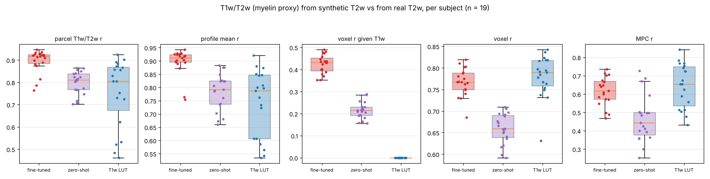
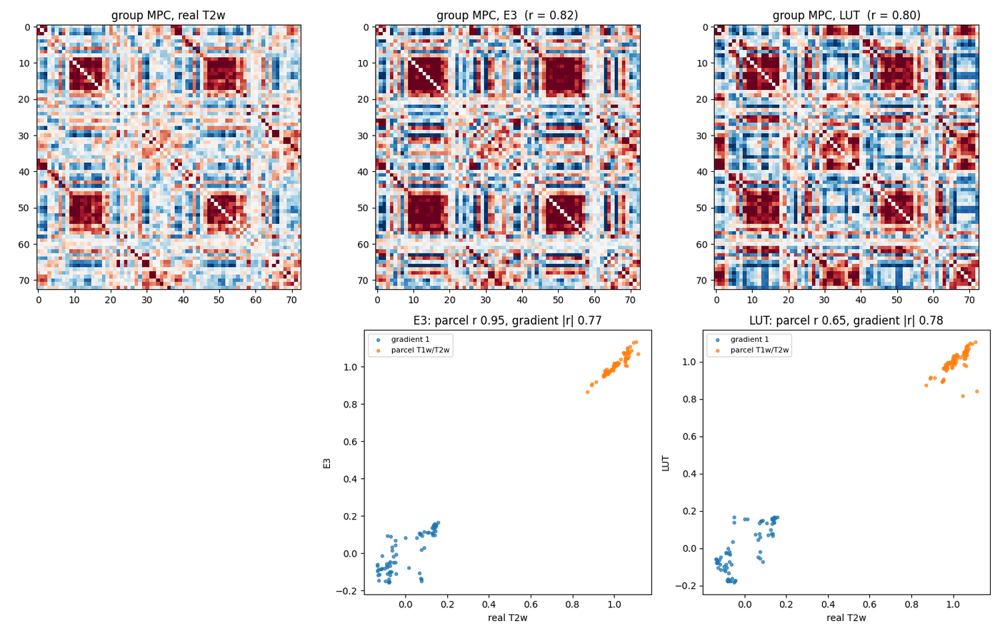

# Synthetic T2w for macaque MRI: adapting GAN-MAT from human to rhesus macaque

This repository adapts **GAN-MAT** (Park et al., *NeuroImage* 2024), a 3D pix2pix generator
trained on human HCP data to synthesise T2-weighted (T2w) images from T1-weighted (T1w)
images, to the **rhesus macaque**, and tests whether the synthetic T2w is good enough for
**T1w/T2w myelin mapping**, so that macaque datasets with only T1w can still be used for
myelin-sensitive analyses.

**Main findings** (19 macaques, PRIME-DE UC Davis, 5-fold subject-level cross-validation,
every subject evaluated once as an unseen test subject):

1. After fine-tuning, the synthetic T2w beats the **best possible voxel-wise mapping from
   T1w intensity** (a lookup table learned on the training subjects) on every image metric
   in the whole brain (19/19 subjects for Pearson r, SSIM, PSNR, beyond-T1 r; 17/19 for MAE;
   Wilcoxon p ≤ 2·10⁻⁵), and it carries substantial T2w information that T1w intensity cannot
   explain (partial correlation given T1w: 0.62).
2. **Human pre-training matters**: at the same training budget (200 epochs), the network
   initialised from the human GAN-MAT weights beats the same network trained from scratch
   on all whole-brain metrics in 19/19 subjects.
3. **Downstream T1w/T2w maps**: parcel-level myelin maps from synthetic T2w agree with
   those from real T2w at r = 0.95 (group average; 0.90 per subject), versus 0.65 for the
   T1w-only control.

Model weights are not released (see [Model weights](#model-weights)). Imaging data are not
included (see [Data](#data)).

---

## Contents

1. [Repository layout](#repository-layout)
2. [Data](#data)
3. [Requirements](#requirements)
4. [Pipeline and how to reproduce](#pipeline-and-how-to-reproduce)
5. [Preprocessing](#preprocessing)
6. [How we fine-tune](#how-we-fine-tune)
7. [How we compare](#how-we-compare)
8. [How the scores are computed](#how-the-scores-are-computed)
9. [Results: synthetic T2w](#results-synthetic-t2w)
10. [Downstream T1w/T2w myelin analysis](#downstream-t1wt2w-myelin-analysis)
11. [Comparison with the original GAN-MAT paper](#comparison-with-the-original-gan-mat-paper)
12. [Development notes and limitations](#development-notes-and-limitations)
13. [Model weights](#model-weights)
14. [Acknowledgements and references](#acknowledgements-and-references)

---

## Repository layout

```
scripts/
  ganmat_env.example.sh   environment template -> copy to ganmat_env.sh and edit
  01_audit.sh             read-only environment check (tools, GPU, data, network)
  02_setup_tools.sh       no-sudo install of ANTs, NMT v2.1 template, Python packages
  06_fetch_ucdavis.py     inventory + download of PRIME-DE UC Davis T1w/T2w
  03_probe_conventions.py measures GAN-MAT's input/target conventions vs the macaque brain
  04_preprocess.py        per-subject macaque preprocessing (9 stages, QC figures, manifest)
  04_run_prep.sh          runs 04 for several subjects in parallel
  04b_seg_check.py        FAST vs SyN-warped NMT segmentation check
  04c_seg_priors.py       FAST with NMT priors; also writes the NMT labels used for evaluation
  04d_nmt_channels.py     input channels from NMT labels (segmentation ablation)
  04e_cohort_qc.py        cohort QC table + montages
  04f_prep_progress.py    progress monitor for batch preprocessing
  05_e2_zeroshot.py       native-space evaluation of any generator checkpoint (+ baselines)
  07_finetune.py          fine-tuning (k-fold splits, frozen BN, masked L1, grad accumulation)
  07_run_cv.sh            runs the folds of one experiment, one fold per GPU
  07b_e3_summary.py       training/validation curves of all runs
  08_eval_cv.py           evaluates every fold, aggregates all subjects, paired tests
  09_myelin.py            downstream T1w/T2w myelin analysis (subject + group level)
results/                  final result tables (CSV)
docs/figures/             QC and result figures
```

The scripts import each other by file name (for example `05_e2_zeroshot.py` reuses the I/O
and QC helpers of `04_preprocess.py`), so keep them in one folder.

## Data

**PRIME-DE, University of California Davis site**: 19 rhesus macaques, anaesthetised,
Siemens Skyra 3T, T1w and T2w at 0.3 mm isotropic (T2w field of view is an exact sub-grid
of the T1w grid). The data are distributed under **CC-BY-NC-SA** by the PRIME-DE consortium
(fcon_1000.projects.nitrc.org/indi/PRIME). They are **not** included here; derived images
(synthetic T2w, ratio maps) are not included either. `06_fetch_ucdavis.py` downloads the
anatomical images from the public `fcp-indi` S3 bucket, or extracts them from the archive
downloaded from the NITRC portal (`--tarball`).

Users of the data must cite PRIME-DE (Milham et al., 2018) and acknowledge the UC Davis
contributors as requested by the PRIME-DE site page.

## Requirements

| Component | Version used | Role |
|---|---|---|
| Python | 3.10 | all scripts (see `requirements.txt`) |
| PyTorch | 2.x with CUDA (bf16 autocast) | generator training and inference |
| ANTs | 2.6.5 | N4, registration, resampling |
| FSL | 6.0.7 | FAST tissue segmentation |
| NMT v2.1 symmetric | — | macaque template, brain mask, segmentation, CHARM atlas |
| GAN-MAT | commit `414f2c7` + released `model.pth` | architecture and human weights |

GPU: one NVIDIA RTX A5000 (24 GB) per training run; a run uses ~7.5 GB and ~2.7 s per
optimiser step at batch 8 (≈15 min for 200 epochs). Preprocessing is CPU-only
(~30–40 min per subject with 8 threads).

GAN-MAT itself is **not** redistributed here: clone it from
github.com/CAMIN-neuro/GAN-MAT and download its `model.pth` as described there.

## Pipeline and how to reproduce

```bash
cp scripts/ganmat_env.example.sh scripts/ganmat_env.sh   # edit WORKSPACE, VENV_PY, FSLDIR
source scripts/ganmat_env.sh
cd scripts

bash 01_audit.sh                               # check the environment
bash 02_setup_tools.sh                         # ANTs, NMT v2.1, Python packages
"$VENV_PY" 06_fetch_ucdavis.py --download      # PRIME-DE UC Davis T1w/T2w (~27 GB archive)

# preprocessing (CPU), 3 subjects at a time, then cohort QC
find "$DATA_DIR" -name "sub-*_T2w.nii*" | grep -o "sub-[0-9]*" | sort -u \
  | xargs -P 3 -I{} bash 04_run_prep.sh --data-dir "$DATA_DIR" {}
"$VENV_PY" 04e_cohort_qc.py                    # review cohort_qc.csv and the montages
# after visual review, mark subjects as reviewed (training and evaluation require it)
for m in "$PROJECT_DIR"/derivatives/prep/sub-*/manifest.json; do
  "$VENV_PY" -c "import json,sys; p=sys.argv[1]; m=json.load(open(p)); m['visual_qc']='PASS'; json.dump(m,open(p,'w'),indent=2)" "$m"
done
ls -d "$PROJECT_DIR"/derivatives/prep/sub-* | xargs -n1 basename \
  | xargs -P 4 -I{} "$VENV_PY" 04c_seg_priors.py --subs {}   # NMT labels for evaluation

# fine-tuning: 5 folds x {human init, from scratch}, one fold per GPU
bash 07_run_cv.sh -- --batch-size 8 --epochs 200 --lr 8e-5 --tag official_long200
bash 07_run_cv.sh -- --init scratch --batch-size 8 --epochs 200 --lr 2e-4 --tag scratch_long200

# evaluation of all folds + zero-shot, aggregated over the 19 test subjects
"$VENV_PY" 08_eval_cv.py --zeroshot --tags official_long200 scratch_long200

# downstream myelin analysis
"$VENV_PY" 09_myelin.py --list-subs | xargs -P 4 -I{} "$VENV_PY" 09_myelin.py --subs {}
"$VENV_PY" 09_myelin.py --group
```

Every long step is restartable: finished stages, folds and evaluations are skipped.

## Preprocessing

`04_preprocess.py`, per subject (native space = the subject's own T1w grid):

1. **Header check**: confirms the T2w grid is an exact sub-grid of the T1w grid (offset of
   80 voxels along x for UC Davis), so T2w can be placed on the T1w grid without interpolation.
2. **N4** bias correction of the whole-head T1w; a 0.6 mm copy for registration.
3. **NMT v2.1 → native** registration with ANTs (rigid, affine, SyN; CC metric).
4. **Brain mask** = NMT brain mask warped through that registration (largest component,
   holes filled); second N4 inside the mask.
5. **T2w** on the T1w grid; a rigid T2w→T1w check at native resolution (applied only if the
   95th-percentile brain displacement exceeds half a voxel; it never did: median p95 motion
   0.015 mm); N4 inside the mask.
6. **Model grid**: native brain → NMT with a 12-DOF brain-only affine (mirroring GAN-MAT's
   native→MNI step), resampled to **256³ at 0.30 mm, LAS orientation**, centred on the NMT
   brain. 0.30 mm is the voxel size at which a macaque brain fills the 256³ grid like a
   human brain fills GAN-MAT's 0.8 mm MNI grid (brain fraction 0.19 vs 0.24 in human).
7. **FAST** (3 classes, `-N`) in the grid → three input channels (CSF, GM, WM), each holding
   the T1w intensity of its voxels and zero elsewhere, exactly as GAN-MAT builds its input.
8. **Target**: T2w in the grid scaled to [-1, 1] as `2·T2/P99.9 − 1` (background −1),
   matching the generator's tanh output convention.
9. **QC figures + automatic checks** (brain volume, T2w FOV coverage, grid margin, FAST
   label order) in `manifest.json`; every subject was also reviewed visually.

Figures: `docs/figures/prep_*.png` (one subject) and `prep_cohort_qc_page*.png` (cohort).


## How we fine-tune

The official GAN-MAT generator (3D pix2pix U-Net, 8 stride-2 levels, 217.6 M parameters) is
initialised from the released human weights and fine-tuned on macaque data
(`07_finetune.py`):

| Setting | Value | Why |
|---|---|---|
| Initialisation | GAN-MAT human weights (`--init official`) | transfer from 752 HCP subjects |
| Input normalisation | **human-matched z-score** (see below) | removes the macaque/human tissue-proportion offset |
| Loss | L1 inside brain ∩ T2w FOV + 0.1 × L1 outside | generator only, no adversarial term |
| BatchNorm | **frozen** (running statistics from human data; affine weights trainable) | the 1×1×1 bottleneck cannot be trained with batch size 1 |
| Dropout | on during training (as in pix2pix), off at inference | regularisation |
| Augmentation | left–right flip, integer shifts up to ±4 voxels | the 256³ network cannot be trained on patches |
| Optimiser | Adam, β = (0.5, 0.999), lr 8·10⁻⁵, cosine decay to 5 % | lr chosen on validation data |
| Batch | effective 8 by gradient accumulation (one volume in memory) | exactly equivalent to a real batch while BN is frozen (checked numerically) |
| Length | 200 epochs (≈ 325 optimiser steps for 13 training subjects) | see development notes |
| Precision | bf16 autocast | |
| Model selection | best validation MAE (2 validation subjects per fold) | test subjects never used |

**Human-matched normalisation.** GAN-MAT z-scores each input channel over the whole 256³
volume, background zeros included, so the normalised values depend on the fraction of the
grid each tissue occupies. Macaque brains have less white matter relative to grey matter than
human brains; the human-matched variant computes each channel's mean and SD as if the tissue
occupied the fraction measured in a human example (CSF 0.0404, GM 0.1091, WM 0.0753 of
256³). With human fractions it equals the official z-score exactly. In the zero-shot setting
it raised SSIM by about 0.17 in both pilot subjects, so it is used throughout.

**From-scratch control.** Same network, data, loss and schedule, random pix2pix
initialisation, BatchNorm in training mode (except the 1×1×1 bottleneck), learning rate
2·10⁻⁴ (best of 8·10⁻⁵ and 2·10⁻⁴ on fold-0 validation), 200 epochs.

## How we compare

* **Cross-validation.** Subject-level 5-fold split (seed 0) written once to
  `splits_k5_seed0.json` and reused by every experiment: per fold 3–4 test subjects,
  2 validation subjects, 13–14 training subjects. Each of the 19 subjects is a test subject
  exactly once; all methods are evaluated on the same subjects, masks and baselines.
* **Native space.** Synthetic T2w is mapped from the model grid back to each subject's own
  T1w grid with the inverse of the brain affine and compared with the acquired T2w there.
* **Methods compared**

  | Name | What it is |
  |---|---|
  | **Fine-tuned (human init)** | GAN-MAT weights fine-tuned on the fold's training subjects |
  | From scratch | same network trained from random weights |
  | Zero-shot | untouched human GAN-MAT (same macaque preprocessing and normalisation) |
  | **T1w LUT** | the best voxel-wise function of T1w intensity: mean normalised T2w per 256 bins of normalised T1w, pooled over the fold's training subjects, applied to the test subject |
  | Inverted T1w | max(T1w) − T1w inside the brain |
  | T1w | the T1w itself (sanity check) |

  The **LUT is the key control**. Any synthetic T2w that is only a function of T1w intensity
  adds nothing to a T1w/T2w ratio; a model has to beat the LUT to be useful.
* **Masks.** *Whole brain* = NMT-derived brain mask ∩ T2w field of view. *Core* = that mask
  eroded by 1 mm, excluding the brain surface where CSF partial volume dominates.
* **Statistics.** Per-subject paired comparisons: number of subjects in which method A is
  better, and the two-sided Wilcoxon signed-rank test over the 19 subjects (`results/cv_paired.csv`).

## How the scores are computed

All image scores are computed per subject in native space, inside the mask, after
normalising **each image independently**:

`x' = clip((x − P1) / (P99 − P1), 0, 1)`, with P1/P99 the 1st/99th percentile inside the mask.

| Score | Definition |
|---|---|
| **MAE** | mean \|x'_synth − x'_real\| over the mask |
| **PSNR** | 20·log10(1 / RMSE), RMSE on x' |
| **Pearson r** | correlation of raw intensities over the mask (scale-invariant) |
| **SSIM** | 3D SSIM (scikit-image, 7³ window, data range 1) computed on x', averaged over mask voxels |
| **beyond-T1 r** | partial correlation of synthetic and real T2w **given T1w intensity**: in the subject and mask, the conditional mean given T1w intensity (256 bins of normalised T1w) is subtracted from both images and the residuals are correlated. Any image that is a function of T1w alone scores 0 by construction (LUT: 0.000, inverted T1w: 0.004) |
| **T1-explainable R²** (reference row) | share of real-T2w variance explained by T1w intensity in that subject: 1 − Var(residual) / Var(real) |
| **GM/WM contrast** | (mean_GM − mean_WM)/(mean_GM + mean_WM) on x', with SyN-warped NMT labels (GM = cortical + deep GM); compare with the real T2w value |

Percentile normalisation is used instead of min–max normalisation because min–max depends
on the single darkest and brightest voxel of each image (vessels, fluid), which made the
min–max MAE track the intensity of a few outliers rather than anatomy.

## Results: synthetic T2w

`results/cv_summary.csv`, `results/cv_paired.csv`, `results/cv_results_long.csv`;
figure `docs/figures/results_image_metrics.png`. Mean ± SD over 19 test subjects.


**Whole brain**

| Method | MAE ↓ | PSNR ↑ | Pearson r ↑ | SSIM ↑ | beyond-T1 r ↑ | GM/WM contrast |
|---|---|---|---|---|---|---|
| **Fine-tuned, human init** | **0.075 ± 0.017** | **19.35 ± 1.16** | **0.744 ± 0.036** | **0.674 ± 0.034** | **0.621 ± 0.066** | 0.047 |
| Same network, from scratch | 0.109 ± 0.023 | 16.78 ± 1.10 | 0.649 ± 0.047 | 0.613 ± 0.037 | 0.554 ± 0.074 | 0.053 |
| Human GAN-MAT, zero-shot | 0.159 ± 0.023 | 14.42 ± 0.90 | 0.570 ± 0.046 | 0.506 ± 0.037 | 0.368 ± 0.047 | 0.128 |
| T1w lookup table (LUT) | 0.142 ± 0.025 | 14.50 ± 0.80 | 0.481 ± 0.057 | 0.567 ± 0.041 | 0.000 | 0.159 |
| Inverted T1w | 0.191 ± 0.037 | 13.08 ± 1.35 | 0.419 ± 0.097 | 0.541 ± 0.051 | 0.004 | 0.190 |
| *Real T2w* | | | | | | *0.051* |

**Core (1 mm eroded)**

| Method | MAE ↓ | PSNR ↑ | Pearson r ↑ | SSIM ↑ | beyond-T1 r ↑ | GM/WM contrast |
|---|---|---|---|---|---|---|
| **Fine-tuned, human init** | 0.096 ± 0.019 | **18.31 ± 1.24** | **0.781 ± 0.040** | 0.608 ± 0.042 | **0.450 ± 0.053** | 0.132 |
| Same network, from scratch | 0.107 ± 0.021 | 16.68 ± 0.99 | 0.658 ± 0.058 | 0.542 ± 0.050 | 0.323 ± 0.069 | 0.155 |
| Human GAN-MAT, zero-shot | 0.136 ± 0.020 | 15.46 ± 0.91 | 0.617 ± 0.054 | 0.493 ± 0.044 | 0.190 ± 0.048 | 0.196 |
| T1w lookup table (LUT) | 0.096 ± 0.014 | 16.88 ± 0.99 | 0.620 ± 0.060 | 0.603 ± 0.046 | 0.044 ± 0.045 | 0.154 |
| Inverted T1w | 0.097 ± 0.014 | 17.39 ± 0.85 | 0.665 ± 0.059 | 0.615 ± 0.049 | 0.006 | 0.179 |
| *Real T2w* | | | | | | *0.083* |

T1w intensity explains 29 % of the real T2w variance in the whole brain and 53 % in the
core (T1-explainable R²), which is why a voxel-wise T1w mapping is a weak predictor
near the brain surface and a strong one in deep tissue.

**Paired comparisons (subjects in which the fine-tuned model is better, Wilcoxon p)**

| vs | Mask | MAE | PSNR | Pearson r | SSIM | beyond-T1 r |
|---|---|---|---|---|---|---|
| T1w LUT | whole brain | 17/19, 2·10⁻⁵ | 19/19, 4·10⁻⁶ | 19/19, 4·10⁻⁶ | 19/19, 4·10⁻⁶ | 19/19, 4·10⁻⁶ |
| T1w LUT | core | 9/19, 0.98 | 17/19, 3·10⁻⁴ | 19/19, 4·10⁻⁶ | 10/19, 0.54 | 19/19, 4·10⁻⁶ |
| From scratch | whole brain | 19/19, 4·10⁻⁶ | 19/19, 4·10⁻⁶ | 19/19, 4·10⁻⁶ | 19/19, 4·10⁻⁶ | 19/19, 4·10⁻⁶ |
| From scratch | core | 12/19, 0.055 | 17/19, 1·10⁻⁴ | 19/19, 4·10⁻⁶ | 19/19, 4·10⁻⁶ | 19/19, 4·10⁻⁶ |
| Zero-shot | both | 19/19 on every score, 4·10⁻⁶ | | | | |

In the core, the fine-tuned model correlates much better with the real T2w than the LUT
and carries far more beyond-T1 information, while MAE and SSIM are on par with the LUT.

**Sensitivity check.** The training length (200 epochs) was decided after inspecting fold-0
test subjects (4 subjects). On the 15 subjects of folds 1–4, which never influenced any
decision, the conclusions are unchanged: whole brain vs LUT, Pearson r 0.744 vs 0.495 and
SSIM 0.676 vs 0.569 (15/15 each), MAE 0.076 vs 0.138 (13/15); vs from scratch 15/15 on all
whole-brain scores; core Pearson r and beyond-T1 r 15/15 vs every control.

## Downstream T1w/T2w myelin analysis

`09_myelin.py`; tables `results/myelin_*.csv`; figures `docs/figures/myelin_*.png` and
`results_myelin_metrics.png`. Volume-based, adapted to the macaque instead of the human
surface pipeline:

| Step | Original paper (human) | Here (macaque) |
|---|---|---|
| Cortex | FreeSurfer surfaces | NMT v2.1 cortical GM mask warped to each subject with its SyN registration |
| Parcels | human atlas | **CHARM** level 5 (macaque cortical hierarchy atlas); parcels ≥ 200 voxels; 73 parcels common to all subjects at group level |
| Depth | 14 equivolumetric surfaces | relative depth d_pial / (d_pial + d_WM) from distance maps, 8 bins (macaque cortex ≈ 2 mm ≈ 6–7 voxels at 0.3 mm) |
| Space | surface | native volume |

**Ratio maps.** For each subject, T1w/T2w is computed from the real T2w, the synthetic T2w of
the fold in which the subject was a test subject, the LUT T2w (training subjects of that
fold) and the zero-shot T2w. All T2w versions are put on one **zero-preserving** scale (real:
T2/P99.9; synthetic: (y+1)/2, which inverts the training target; LUT fitted on that scale), so
ratio maps differ only by a global factor; each map (T1w / max(T2w, 0.02)) is divided by its
cortical median.

**Scores (synthetic-based vs real-based ratio maps)**

| Score | Definition |
|---|---|
| voxel r | correlation over cortical voxels |
| voxel r given T1w | partial correlation of log T2w (synthetic vs real) given T1w intensity, binned like the LUT. Because log(T1/T2) = log T1 − log T2 and log T1 is shared by all maps, this is the information in the ratio map beyond T1w; LUT scores exactly 0 |
| relative MAE | mean \|R_synth − R_real\| / mean R_real |
| parcel r | correlation of parcel-mean ratios across parcels |
| profile moments r | mean, SD, skewness, kurtosis of each parcel's depth profile, correlated across parcels |
| MPC r | microstructural profile covariance: partial correlation between parcel depth profiles given the mean profile (Fisher z); correlation of upper triangles |
| gradient r | first diffusion-map gradient of the group MPC (row-wise 90 % sparsity, normalised-angle affinity, α = 0.5); absolute correlation |

**Per subject (mean ± SD, n = 19)**

| Score | Fine-tuned | T1w LUT | Zero-shot | Fine-tuned better than LUT |
|---|---|---|---|---|
| **parcel r** | **0.895 ± 0.052** | 0.754 ± 0.154 | 0.799 ± 0.052 | 19/19, p = 4·10⁻⁶ |
| **profile mean r** | **0.896 ± 0.051** | 0.741 ± 0.127 | 0.784 ± 0.070 | 19/19, p = 4·10⁻⁶ |
| **voxel r given T1w** | **0.425 ± 0.043** | 0.000 | 0.215 ± 0.038 | 19/19, p = 4·10⁻⁶ |
| profile SD r | 0.756 ± 0.144 | 0.685 ± 0.122 | 0.582 ± 0.176 | 13/19, p = 0.03 |
| profile skewness r | 0.753 ± 0.083 | 0.728 ± 0.078 | 0.630 ± 0.088 | 14/19, p = 0.08 |
| profile kurtosis r | 0.586 ± 0.129 | 0.536 ± 0.124 | 0.403 ± 0.112 | 13/19, p = 0.08 |
| voxel r | 0.767 ± 0.033 | **0.780 ± 0.048** | 0.659 ± 0.035 | 2/19 |
| relative MAE ↓ | 0.076 ± 0.005 | **0.067 ± 0.006** | 0.201 ± 0.013 | 0/19 |
| MPC r | 0.615 ± 0.078 | 0.647 ± 0.121 | 0.466 ± 0.129 | 7/19, p = 0.20 |

**Group average (73 parcels)**

| Score | Fine-tuned | T1w LUT | Zero-shot |
|---|---|---|---|
| parcel r | **0.947** | 0.654 | 0.855 |
| MPC r | **0.816** | 0.802 | 0.719 |
| gradient 1 \|r\| | 0.768 | 0.780 | **0.858** |
| profile mean r | **0.947** | 0.611 | 0.835 |
| profile SD r | **0.896** | 0.745 | 0.708 |
| profile skewness r | **0.776** | 0.625 | 0.677 |
| profile kurtosis r | **0.740** | 0.440 | 0.471 |





**Interpretation.** The synthetic T2w restores the **regional** myelin pattern (parcel-level
ratio r 0.95 vs 0.65 for T1w alone) and the mean laminar profile. Voxel-wise ratio
similarity and MPC/gradient similarity, however, are reached equally well by the T1w-only
LUT: the shared T1w numerator dominates voxel-wise variation, and in this volume-based
implementation the depth-profile covariance is largely determined by T1w laminar contrast.
MPC and gradient similarity therefore cannot on their own demonstrate the value of a
synthetic T2w; parcel-level maps, profile means and the given-T1w partial correlation can.

## Comparison with the original GAN-MAT paper

Original values: GAN-MAT bioRxiv preprint (10.1101/2023.04.20.537642), HCP test set. The
pipelines differ (surfaces with 14 depths in human vs volume with 8 depth bins and CHARM
parcels here), so the comparison indicates the level of agreement, not a like-for-like test.

| Feature similarity (real vs synthetic) | Human, original paper | Macaque, here (group) | Macaque, T1w-only control |
|---|---|---|---|
| Microstructural gradient | 0.71 | 0.77 | 0.78 |
| Profile mean | 0.70 | 0.95 | 0.61 |
| Profile SD | 0.53 | 0.90 | 0.75 |
| Profile skewness | 0.77 | 0.78 | 0.63 |
| Profile kurtosis | 0.63 | 0.74 | 0.44 |

The original paper did not include a T1w-only control; the last column shows why one is
needed when interpreting gradient similarity.

## Development notes and limitations

* **Why preprocessing mattered.** A first pilot with BET + FLIRT to human MNI gave a T1w–T2w
  correlation of +0.47 inside the "brain" mask; with the NMT-based mask it is −0.42 to −0.73,
  showing that the pilot mask contained non-brain tissue. Every result above uses the
  macaque pipeline.
* **FAST in the macaque.** With a tight macaque brain mask there is little CSF, and FAST labels
  much of deep grey matter and part of the cortical ribbon as WM (WM ≈ 54 % of the brain vs
  ≈ 30 % in the NMT segmentation). NMT priors (`-P`) did not change this. Segmentation was
  therefore tested as a factor in the zero-shot experiment: plain FAST (which treats deep GM
  as WM, like FAST on human T1w) performed best with the human-matched normalisation and is
  used for all models. NMT labels are used only for evaluation (GM/WM contrast).
* **Training length.** Recipes were selected on fold-0 validation subjects. A 60-epoch
  schedule first suggested that from-scratch training was far worse; a 200-epoch from-scratch
  run closed most of that gap on validation, so both initialisations were retrained for 200
  epochs. At equal length, human initialisation remains better on the test subjects. The
  choice of 200 epochs used fold-0 test results; see the folds 1–4 sensitivity check above.
* **Validation MAE is not a test proxy.** Validation MAE (grid space, [-1, 1] target units)
  was almost identical for the two 200-epoch models (0.083 vs 0.082) although the native-space
  test metrics differed clearly; it mostly reflects intensity calibration.
* **Scope.** One site (UC Davis), one scanner, anaesthetised adult rhesus macaques, n = 19.
  Generalisation to other sites, species, ages and awake scanning is untested. The myelin
  analysis is volume-based; a surface-based macaque pipeline remains future work. In the core
  region the fine-tuned model exaggerates GM/WM contrast (0.132 vs 0.083 in real T2w), as do
  the LUT and the other controls.

## Model weights

The fine-tuned checkpoints are derived from the GAN-MAT weights, whose repository specifies
no licence. They are therefore **not released**; please contact the authors. All code to
reproduce them from the GAN-MAT release and PRIME-DE data is in `scripts/`.

## Acknowledgements and references

* Park et al. (2024). GAN-MAT: Generative adversarial network-based microstructural profile
  covariance analysis toolbox. *NeuroImage*. Code: github.com/CAMIN-neuro/GAN-MAT.
* Milham et al. (2018). An open resource for non-human primate imaging. *Neuron* (PRIME-DE).
  Data: PRIME-DE University of California Davis site, CC-BY-NC-SA.
* Jung et al. (2021). A comprehensive macaque fMRI pipeline and hierarchical atlas.
  *NeuroImage* (NMT v2, CHARM).
* Avants et al., ANTs; Jenkinson et al., FSL (FAST: Zhang et al., 2001).
* Paquola et al. (2019). Microstructural and functional gradients are increasingly dissociated
  in transmodal cortices. *PLoS Biology* (MPC).
